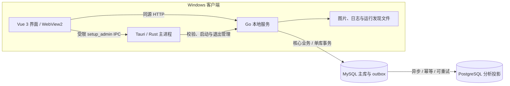

# 岁宁架构总览

当前实现：**Tauri 2 / Rust + Windows WebView2 + Vue 3 / Vite + Go + MySQL 业务主库 + PostgreSQL 分析库**。本文解释整体分工；接口路径、进程协议和故障处理见 [实现架构](../ARCHITECTURE.md)。

PG 暂不可用时仅分析延迟；账号、建档、设备上报及照护事务继续走 MySQL。详见 [双库部署与验收](../DUAL_DATABASES.md)。

## 设计目标

软件界面能够独立打开，数据库作为单独部署的服务存在。数据库不可用时，不以连接页取代整个软件；只有依赖业务数据的功能提示不可用。网络恢复后自动尝试事先配置的连接，保留页面与输入，但不重放失败写入。

Windows 桌面把界面、原生壳与业务服务分开：Rust 管窗口和进程，Vue 管交互，Go 管业务及数据访问。浏览器不直接连接任一数据库，也不持有数据库凭据或桌面初始化令牌。

## 系统关系

数据库可以在本机独立运行，也可以位于部署方管理的服务器。Windows 默认 Go 监听回环动态端口，不能把该端口直接当作互联网手表入口；真实设备接入需单独安排受控网络部署。

## 分层与源码位置

| 层 | 入口 | 主要职责 |
| --- | --- | --- |
| 桌面 | [desktop](../../智慧养老手表管理系统/desktop) | 单实例、窗口、sidecar 哈希、原生命令、生命周期 |
| 界面 | [frontend/src](../../智慧养老手表管理系统/frontend/src) | 页面、路由、状态提示、图表与表单 |
| 服务 | [backend/cmd/server](../../智慧养老手表管理系统/backend/cmd/server) | 监听、后台连接恢复、API 发布与进程监护 |
| 业务 | [backend/internal](../../智慧养老手表管理系统/backend/internal) | 鉴权、会话、请求防护、处理器与连接池 |
| 数据变更 | [migrations](../../智慧养老手表管理系统/backend/migrations) | 内嵌 SQL、版本记录、关系约束 |
| 验收工具 | [前端 QA](../../智慧养老手表管理系统/frontend/qa) / [watch-sim](../../智慧养老手表管理系统/watch-sim) | 界面回归与手表协议模拟，不能替代实机 |

前端源码位于 `智慧养老手表管理系统/frontend`，Go 后端位于 `智慧养老手表管理系统/backend`。

## 生命周期与可用性

1. Rust 校验随包 Go 程序，创建随机桌面令牌并启动子进程。
2. Go 先监听并提供内嵌界面，再后台连接 MySQL；迁移完成前不发布数据库业务 API。
3. Rust 验证就绪文件中的 PID 和动态端口，再加载唯一允许的本机 origin。
4. Vue 直接显示界面，后台检查数据库状态；连接不可用时仅在页面内提示，普通窗口操作仍可用。
5. 连接恢复后检查会话与初始化状态。权限不因离线放宽，失败写入不进入重试队列。
6. 窗口退出时由 Rust 请求 Go 安全退出，必要时终止子进程；Go 同时监测父进程是否存在。

当前退出登录仍须通过会话与 CSRF 校验；默认数据库会话的服务端撤销依赖 MySQL，主库断开时可能返回 503，不能将浏览器清除 Cookie 等同于服务端撤销成功。

## 数据与安全边界

- MySQL 保存核心业务、加密数据库会话和分析 outbox，PG 保存可重建的分析投影；Windows 本地目录保存图片、日志与运行文件。只有显式启用单实例开发选项 `SESSION_BACKEND=memory` 才把会话保存在 Go 进程内存。数据库与图片需要分别备份。
- `setup_admin` 仅向允许的主窗口提供，Rust 再检查实际页面 origin；网页不获取桌面令牌。
- 业务接口在 Go 中执行会话、角色与 CSRF 校验，设备接口使用设备鉴权。
- MySQL 迁移通过连接级锁与校验和协调，PG 分析迁移使用事务及 advisory lock；不自动删除遗留数据。
- 数据库与图片分别备份；旧业务库迁移必须使用明确的离线导入流程，不能假设安装程序会自动转换数据。

## 构建与平台边界

Vue 生产构建 → 嵌入 Go 前端资源 → Go 测试与编译 → sidecar 签名及哈希 → Tauri 编译 → NSIS 打包。Windows Setup 缺失 WebView2 时联网静默补装共享运行时，免安装 ZIP 使用系统已有运行时。

当前桌面交付目标为 Windows x64。其他操作系统的原生桌面打包与验收不在当前支持承诺内。

## 维护入口

[构建](../BUILD.md) · [使用](../SETUP.md) · [测试](../TESTING.md) · [备份](../runbooks/backup-restore.md) · [文件职责](../FILES.md) · [ADR-0006](../decisions/0006-tauri-go-postgres.md)

所有发布资产必须关联明确的源码提交，并区分自动化检查、模拟测试与真实设备/生产环境验收。
